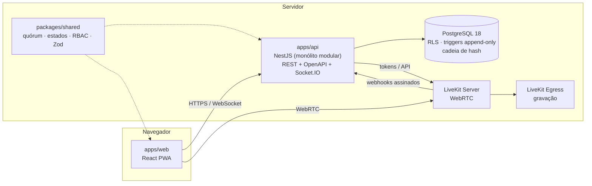

# LS Global Assembleias

Plataforma SaaS **multi-tenant** para assembleias condominiais **presenciais, virtuais e híbridas**: convocação,
credenciamento, procurações, votação com quórum exato, transmissão ao vivo, pedido de palavra, gravação e
auditoria à prova de adulteração.


---

## Sumário

- [Funcionalidades](#funcionalidades)
- [Situação do projeto](#situação-do-projeto)
- [Arquitetura](#arquitetura)
- [Estrutura do repositório](#estrutura-do-repositório)
- [Começando](#começando)
- [Transmissão ao vivo (LiveKit)](#transmissão-ao-vivo-livekit)
- [Roteiro de demonstração](#roteiro-de-demonstração)
- [Scripts](#scripts)
- [Testes](#testes)
- [Configuração](#configuração)
- [Segurança](#segurança)
- [Documentação](#documentação)
- [Avisos](#avisos)

---

## Funcionalidades

| Área | O que faz |
|---|---|
| **Multi-tenant** | Administradoras e condomínios isolados por tenant, na API e no banco (Row-Level Security) |
| **Cadastros** | Condomínios, unidades (importação em lote), pessoas, coproprietários, regras de quórum por condomínio |
| **Procurações** | Envio, análise, aprovação/revogação; procurador representando várias unidades |
| **Convocação** | Edital imutável após publicação, envio por e-mail com fila e novas tentativas, link pessoal, retificação, comprovante |
| **Credenciamento** | Presença presencial e remota, por unidade, com elegibilidade recalculada em tempo real |
| **Votação** | Votos abertos ou sigilosos, comprovante, envio idempotente, 1ª/2ª convocação, fração ideal, quórum especial (ex.: 2/3) |
| **Apuração** | Motor de quórum com aritmética exata (`BigInt`), sem erro de arredondamento |
| **Mesa diretora** | Condução da sessão, abertura/encerramento de pautas, cancelamento e nova rodada, declaração do resultado |
| **Transmissão** | Sala de vídeo LiveKit com token por papel, fila de pedido de palavra, gravação com SHA-256 |
| **Auditoria** | Registro append-only em cadeia de hash, verificação de integridade e exportação |
| **Acesso** | Login com MFA (TOTP), rotação de refresh token com detecção de reuso, bloqueio por tentativas, RBAC |
| **PWA** | Front-end instalável; sala do condômino funciona bem no celular |

## Situação do projeto

| Fase | Escopo | Situação |
|---|---|---|
| 1 | Fundação: auth, MFA, multi-tenant, RBAC, auditoria | ✅ Pronta |
| 2 | Cadastros e convocação por e-mail | ✅ Pronta |
| 3 | Votação e quórum | ✅ Pronta |
| 4 | Transmissão, palavra e gravação (LiveKit) | 🟡 Implementada; sala, tokens, webhooks e palavra validados com LiveKit real em localhost. **Gravação (Egress) e uso em rede externa ainda não validados** |
| 5 | WhatsApp e serviço gerenciado | ⬜ Não iniciada |
| 6 | Comercial e faturamento | ⬜ Não iniciada |

Detalhes e próximas histórias: [docs/05-backlog.md](docs/05-backlog.md).

## Arquitetura



| Camada | Tecnologia |
|---|---|
| Front-end | React 18.3, TypeScript 5.9, Vite 6, Ant Design 5, TanStack Query 5, React Router 6, React Hook Form + Zod 4, PWA |
| Back-end | Node.js 22, NestJS 11, REST + OpenAPI, Socket.IO |
| Banco | PostgreSQL 18 nativo, com RLS, triggers append-only e cadeia de hash |
| Mídia | LiveKit Server (binário nativo), Egress e Redis no WSL, coturn para relay TURN |
| Domínio compartilhado | `@lsg/shared`: motor de quórum, máquinas de estado, permissões, esquemas Zod |

Tudo roda **sem Docker**. Mais detalhes em [docs/02-arquitetura.md](docs/02-arquitetura.md).

## Estrutura do repositório

```
.
├── apps/
│   ├── api/                 NestJS
│   │   ├── migrations/      SQL versionado com checksum (RLS, constraints, triggers)
│   │   ├── src/modules/     accreditation, assemblies, condominiums, convocations, media,
│   │   │                    people, platform, poa, rules, users, voting
│   │   └── test/            testes de integração (e2e)
│   └── web/                 React PWA: painel, cadastros, mesa diretora, credenciamento, sala do condômino
├── packages/
│   └── shared/              motor de quórum/apuração, estados, RBAC, validações
├── infra/
│   ├── windows/             LiveKit nativo, firewall, túnel Pinggy
│   └── wsl/                 Redis, Egress e coturn na distro WSL "LSG"
├── docs/                    requisitos, arquitetura, modelo de dados, riscos, backlog, permissões, OpenAPI
├── iniciar.bat              sobe o ambiente completo no Windows
└── pinggy.bat               publica o ambiente local na internet (teste externo)
```

## Começando

### Pré-requisitos

- **Node.js ≥ 22**
- **PostgreSQL** (testado no 18, porta 5433)
- Opcional, para transmissão: LiveKit Server e WSL. Veja [Transmissão ao vivo](#transmissão-ao-vivo-livekit).

### Instalação

```bash
git clone https://github.com/princebsb/lsglobal.git
cd lsglobal

cp .env.example .env        # ajuste DATABASE_ADMIN_URL e gere os segredos indicados no arquivo
npm install
npm run setup               # build do shared, cria papel e bancos, aplica migrações e dados de demonstração
npm run dev                 # API em :3333 e web em :5173
```

| Serviço | Endereço |
|---|---|
| Web | http://localhost:5173 |
| API | http://localhost:3333/api/v1 |
| OpenAPI (Swagger) | http://localhost:3333/api/docs |

> **HTTPS local:** se existirem `.certs/dev-cert.pem` e `.certs/dev-key.pem` na raiz (fora do Git), o Vite serve
> em `https://localhost:5173`. É necessário para microfone e câmera fora de `localhost`.

### Usuários de demonstração

Criados pela seed, **somente para uso local**. Senha de todos: `Demo@LSG2026`.

| Usuário | Papel |
|---|---|
| `admin@lsglobal.local` | Administrador da plataforma |
| `gestor@horizonte.demo` | Administradora |
| `sindico@acacias.demo` | Síndico |
| `presidente@acacias.demo` | Mesa diretora |
| `credenciamento@acacias.demo` | Credenciamento |
| `ana@acacias.demo` | Condômina com 2 unidades |
| `bruno@`, `carla@`, `daniel@acacias.demo` | Condôminos |
| `karina@acacias.demo` | Coproprietária designada |
| `marina@acacias.demo` | Procuradora |
| `admin@beta.demo` | Outro cliente (teste de isolamento) |

## Transmissão ao vivo (LiveKit)

Sem as variáveis `LIVEKIT_*` no `.env`, a transmissão aparece como "não configurada" e o resto do sistema funciona
normalmente. Para ativá-la no Windows:

```powershell
# tudo de uma vez: PostgreSQL, Redis + Egress (WSL), LiveKit, API e web
iniciar.bat

# ou passo a passo
wsl -d LSG -u root -- bash "/mnt/d/LS GLOBAL/infra/wsl/start-media.sh"
powershell -ExecutionPolicy Bypass -File infra\windows\start-livekit.ps1
npm run dev
```

Para testar com quem está fora da rede local (4G, outra casa), rode `pinggy.bat` em outra janela. Ele exige
`PINGGY_TOKEN` no `.env`.

Instalação, gravação, produção e pendências: [docs/08-transmissao-livekit.md](docs/08-transmissao-livekit.md).

## Roteiro de demonstração

0. **Convocação:** `sindico@` → nova assembleia → pauta → homologar → *Aprovada para convocação* → aba
   **Convocação** → redigir e **Publicar e enviar**. Com `MAIL_DRIVER=file`, os e-mails ficam em
   `apps/api/storage/outbox/*.eml`. Abra um deles e siga o link pessoal `/c/...`.
1. `presidente@` → Assembleias → 2026-001 → **Abrir credenciamento**.
2. `sindico@` → Condomínios → Procurações → analisar a procuração pendente.
3. `ana@` (outra janela ou aba anônima) → Sala → **Confirmar presença** nas duas unidades.
4. `presidente@` → **Iniciar sessão** (1ª convocação) → Mesa diretora → **Abrir** votação.
5. `ana@` → **Votar** → recebe o comprovante.
6. `presidente@` → Encerrar → Apurar → Declarar. Exportar presença e resultado. Auditoria → **Verificar integridade**.

## Scripts

| Comando | Descrição |
|---|---|
| `npm run dev` | API e web em modo de desenvolvimento |
| `npm run setup` | Build do shared, criação dos bancos, migrações e seed |
| `npm run db:migrate` | Aplica migrações pendentes |
| `npm run db:seed` | Recria os dados de demonstração |
| `npm run build` | Build de produção de shared, API e web |
| `npm run typecheck` | Verificação de tipos em todos os pacotes |
| `npm test` | Testes unitários e de integração |
| `npm run test:unit` | Só os unitários (`@lsg/shared`) |
| `npm run test:integration` | Só os de integração (API) |

## Testes

```bash
npm test    # 36 unitários (shared) + 62 de integração (API, banco de teste recriado a cada execução)
```

Os testes de integração usam um banco PostgreSQL real (`DB_TEST_NAME`). Eles cobrem:

- **Representação:** titular com duas unidades, coproprietários, procurador com várias unidades, procuração pendente ou revogada
- **Votação:** voto duplicado, 8 votos simultâneos (exatamente 1 aceito), reenvio idempotente após reconexão,
  duas sessões de navegador, presencial + remoto, mudança de elegibilidade
- **Quórum:** 1ª/2ª convocação, fração ideal, quórum especial (2/3), votação sigilosa, cancelamento e nova rodada
- **Segurança:** isolamento entre tenants (API e RLS), MFA, rotação de refresh token com detecção de reuso,
  bloqueio por tentativas, append-only, exportação e detecção de adulteração da auditoria
- **Convocação:** edital imutável, destinatários, fila com nova tentativa, link pessoal, retificação, comprovante
- **Transmissão:** token por papel, fila de palavra, gravação confirmada por webhook assinado, SHA-256, idempotência

## Configuração

Todas as variáveis estão comentadas em [`.env.example`](.env.example). As principais:

| Variável | Para quê |
|---|---|
| `DATABASE_ADMIN_URL` | Conexão administrativa, usada só por `db:setup` e `db:migrate` |
| `DB_APP_USER` / `DB_APP_PASSWORD` | Papel da aplicação: sem superusuário e sem `BYPASSRLS`, para o RLS valer |
| `JWT_SECRET` | Assinatura dos tokens de acesso (mínimo 32 caracteres) |
| `DATA_ENCRYPTION_KEY` | AES-256-GCM para dados pessoais (CPF/CNPJ, segredo MFA) |
| `DATA_HMAC_KEY` | Índice cego para busca de documentos sem expor o CPF |
| `MFA_ENFORCE_ADMIN` | Exige MFA para perfis administrativos. **Use `true` fora do ambiente local** |
| `MAIL_DRIVER` | `file` grava `.eml` localmente; `smtp` envia de verdade (`SMTP_URL`) |
| `LIVEKIT_URL`, `LIVEKIT_API_KEY`, `LIVEKIT_API_SECRET` | Ativam a transmissão |
| `LIVEKIT_EGRESS_ENABLED` | Ativa a gravação integral (exige o Egress rodando) |
| `PINGGY_TOKEN` | Chave do túnel usado por `pinggy.bat` |

## Segurança

- **Isolamento por tenant** garantido também no banco, por Row-Level Security, e não só na API.
- **Auditoria imutável:** triggers impedem `UPDATE`/`DELETE`, e cada registro encadeia o hash do anterior.
- **Dados pessoais cifrados** em repouso (AES-256-GCM) e com índice cego (HMAC).
- **Sessões:** MFA por TOTP, refresh token rotativo com detecção de reuso, bloqueio após tentativas falhas.
- **Segredos fora do Git:** `.env` e `.certs/` estão no `.gitignore`. Nunca versione chaves reais.

## Documentação

| Documento | Conteúdo |
|---|---|
| [01 — Análise de requisitos](docs/01-analise-requisitos.md) | Inconsistências, decisões, obrigatórios × opcionais |
| [02 — Arquitetura](docs/02-arquitetura.md) | Princípios, módulos da API, fila de envios |
| [03 — Modelo de dados](docs/03-modelo-dados.md) | Entidades e relacionamentos |
| [04 — Riscos](docs/04-riscos.md) | Matriz de riscos |
| [05 — Backlog](docs/05-backlog.md) | Situação por fase e próximas histórias |
| [06 — Matriz de permissões](docs/06-matriz-permissoes.md) | O que cada papel pode fazer |
| [08 — Transmissão (LiveKit)](docs/08-transmissao-livekit.md) | Instalação, gravação, produção, teste externo |
| [OpenAPI](docs/openapi.json) | Especificação da API REST |

## Avisos

- Os modelos de regras jurídicas e os textos legais são **pontos de partida sujeitos a validação profissional**.
- O registro de envio e abertura da convocação **não** comprova, sozinho, a validade jurídica da convocação.
- Não use a seed nem `MFA_ENFORCE_ADMIN=false` fora do ambiente local.

---

© LS Global Tecnologia
