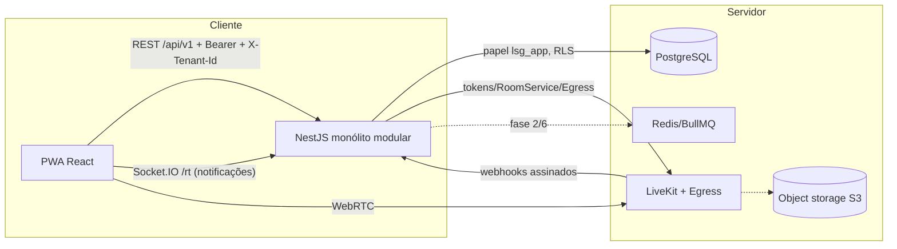

# 02 — Arquitetura

## Princípios
- **Servidor autoritativo.** O WebSocket só notifica; a tela reconsulta a API (com reconciliação periódica).
- **Isolamento em profundidade.** (1) guard valida `X-Tenant-Id` contra os vínculos do usuário; (2) cada requisição roda em
  transação com `set_config('app.tenant_id')`; (3) **RLS forçado** em todas as tabelas de cliente; (4) FKs compostas
  `(tenant_id, id)` impedem referências cruzadas; (5) o papel `lsg_app` não é superusuário nem tem BYPASSRLS.
- **Votos imutáveis.** `votes`, `vote_participations`, `secret_ballot_entries`, `ballot_electorate`, `ballot_results`
  e `audit_events` são append-only (triggers + revogação de UPDATE/DELETE). Substituição de voto = nova versão.
- **Concorrência.** Voto: `SELECT … FOR SHARE` na votação; encerramento: `FOR UPDATE`. Unicidade `(ballot, unit, version)`
  e `(ballot, idempotency_key)`; savepoint converte violação em resposta idempotente ou 409.
- **Integridade.** Cadeia de hash por tenant na auditoria e por votação nos votos; hash SHA-256 do resultado e dos
  arquivos exportados. Verificação em `audit_verify_chain()`.
- **Regras como dados.** `quorum_rules` versionadas, imutáveis após homologação; snapshot da regra gravado no resultado.
- **Aritmética exata.** Frações ideais em `numeric(14,10)` e BigInt na apuração (sem ponto flutuante).

## Módulos da API
`auth` (login, TOTP, refresh rotativo) · `platform` · `users` · `condominiums` (+ importação) · `people` · `poa` ·
`rules` · `assemblies` (estados, sessões, pauta, homologação, quórum, simulação) · `accreditation` · `voting` ·
`convocations` (edital, fila de e-mail, link público) · `media` (LiveKit: tokens, palavra, gravação, webhooks) ·
`reports` · `audit` · `realtime`.

## Fila de envios (sem Redis)
`convocation_deliveries` funciona como outbox no PostgreSQL. A função `convocation_claim_deliveries` reserva lotes com
`FOR UPDATE SKIP LOCKED` e um lease, de modo que várias instâncias podem processar sem duplicar envios e envios presos
são retomados. O processamento ocorre em transação com o tenant do envio (RLS).

## Fase 4 — transmissão e gravação (ver 08-transmissao-livekit.md)
LiveKit (binário nativo Windows/Linux) + Egress para composição MP4 em S3; webhooks do LiveKit alimentam
`recordings`/`assembly_timeline_events`; ingestão RTMP/WHIP para equipamentos externos; tokens de sala emitidos pela API
por papel (falar/assistir). A linha do tempo já é gravada com horário do servidor para sincronização com o vídeo.
