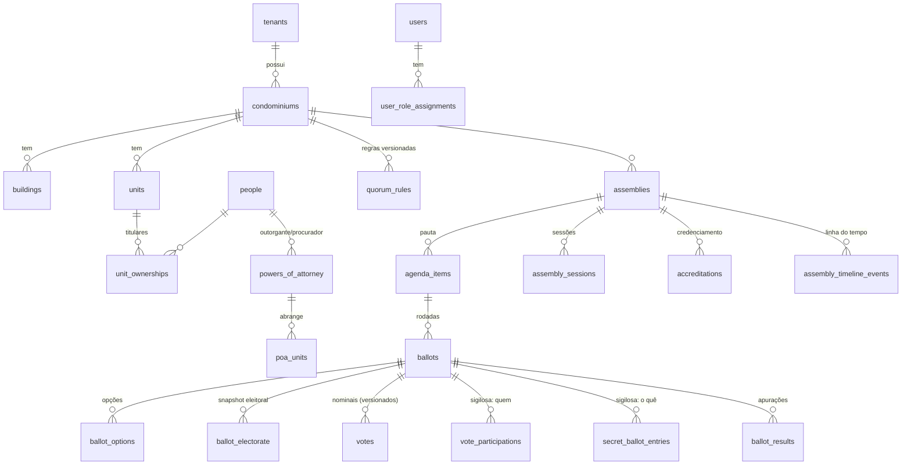

# 03 — Modelo de dados

Migrações: `apps/api/migrations/0001…0008`. Diagrama simplificado:

| Tabela | Observações |
|---|---|
| `users` | globais; Argon2id; segredo TOTP cifrado (AES-256-GCM) |
| `people` | CPF/CNPJ cifrado + índice cego HMAC + máscara |
| `unit_ownerships` | um único representante votante ativo por unidade (índice parcial) |
| `powers_of_attorney` | estados pending/approved/rejected/revoked; rejeição e revogação exigem fundamento (CHECK) |
| `quorum_rules` | imutável após `approved` (trigger); `definition` JSON validado por Zod |
| `accreditations` | um credenciamento ativo por (assembleia, unidade) — evita dupla contagem |
| `ballots` | snapshot de eleitorado e de presença imutáveis (trigger 0005) |
| `votes` | append-only, `(ballot, unit, version)` único, cadeia de hash |
| `audit_events` | append-only, cadeia SHA-256 por tenant, RLS de leitura |
| `convocations` | edital versionado; após publicado, conteúdo + snapshot (pauta/datas) imutáveis com SHA-256; uma versão vigente por assembleia |
| `convocation_recipients` | snapshot de destinatários (unidade, pessoa, endereço); link pessoal por hash + token cifrado; append-only |
| `convocation_deliveries` | fila (outbox) com lease, tentativas e nova tentativa progressiva; reservada por função SECURITY DEFINER |
| `convocation_delivery_events` | append-only: queued, sent, failed, retry_scheduled, skipped_no_address, opened, resend_requested |
| `media_rooms` | uma sala LiveKit por assembleia (`lsg_{assemblyId}`) |
| `floor_requests` | fila de palavra; uma solicitação ativa por pessoa; um orador por vez (índices parciais) |
| `recordings` | gravações Egress; início/fim pelo servidor de mídia; SHA-256; imutável após concluída/falha |
| `media_webhook_events` | webhooks do LiveKit, idempotentes pelo id do evento; append-only |

Entidades do prompt §28 ainda não criadas (fases futuras): incidentes,
equipamentos, fornecedores, ordens de serviço, checklists, propostas, contratos, planos, assinaturas, faturas,
pagamentos, chamados, notificações, relatórios gerados.
